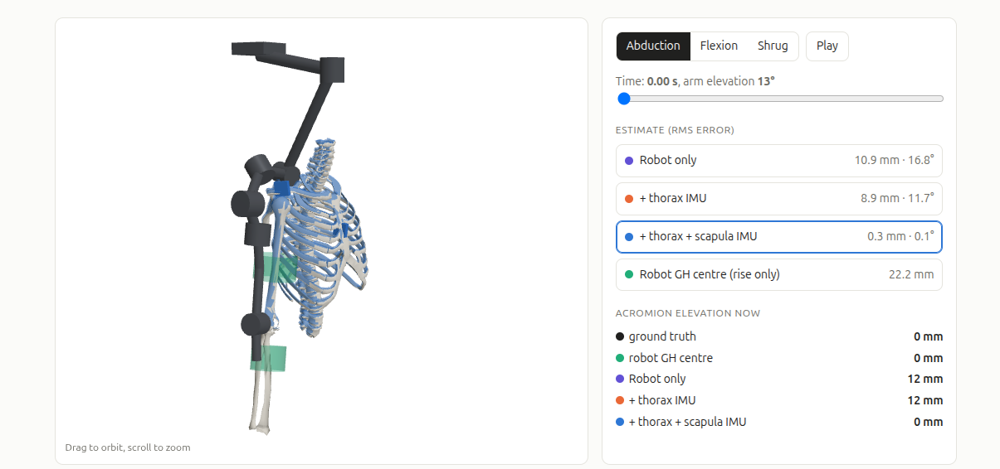
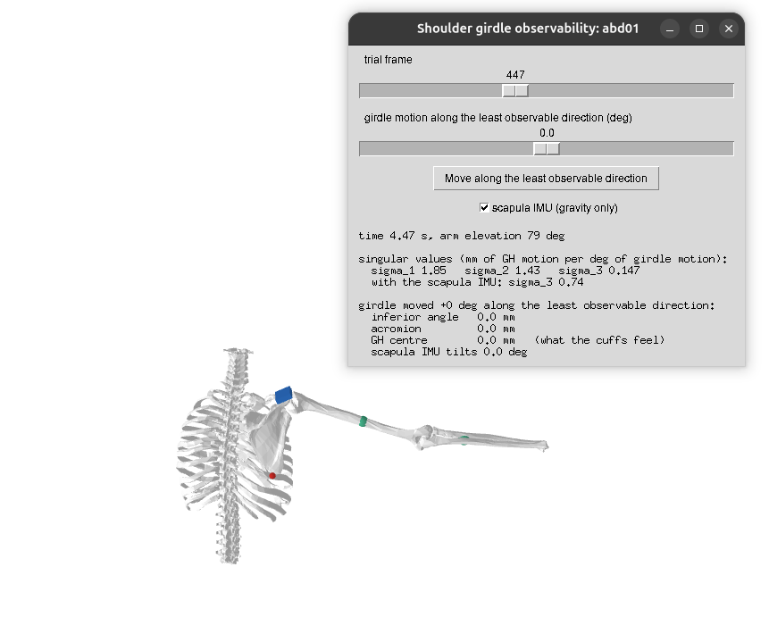
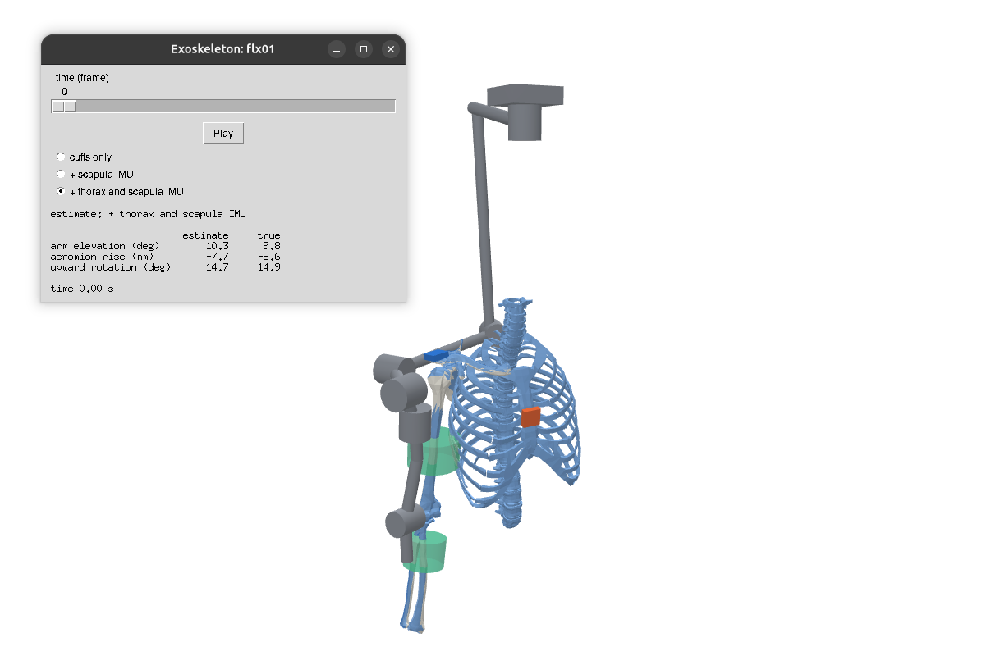

# Shoulder girdle estimation with an upper-limb exoskeleton

Companion code and interactive pages to an ICORR paper (in review) on estimating shoulder girdle elevation with an upper-limb exoskeleton.


An exoskeleton holds the arm with two cuffs. It knows where the cuffs are, but it cannot see the shoulder girdle (clavicle and scapula), which joins the arm only at the glenohumeral (GH) joint. This repository shows which girdle motions the cuffs can sense, and how well the girdle can be reconstructed from the cuffs alone, with a thorax IMU, and with a thorax and a scapula IMU.

### Online live demo

<a href="https://askuric.github.io/exoskeleton-shoulder-girdle/">

</a>

**Live pages: [askuric.github.io/exoskeleton-shoulder-girdle](https://askuric.github.io/exoskeleton-shoulder-girdle/)**

## Contents

```
girdle/                     the method, as a small Python package
  model.py                  the shoulder model of Seth et al.: frames, AC loop, dataset trials
  observability.py          singular values and the least observable girdle motion
  robot.py                  a generic arm exoskeleton
  estimation.py             model IK (pink + quadprog, as in the paper): fit the shoulder model to the cuffs (and IMUs)
scripts/
  observability.py          observability along a trial: plots, or a 3D viewer with sliders
  exoskeleton_live.py       move the exoskeleton (or let it follow a trial) and see the reconstruction
public/                     the web pages (GitHub Pages)
```


## Conda environment and dependencies

1. Install the environment:
   ```
   conda env create -f environment.yaml
   conda activate shoulder-girdle
   ```
2. Download the materials of Seth et al. from [simtk.org/projects/thoracoscapular](https://simtk.org/projects/thoracoscapular) and unpack them as `ThoracoscapularShoulderPaperMaterials/` in this folder (or pass `--data <folder>`). The scripts use the model (`Model/`) and the IK results of the dataset (`Results/IK/*_IK.mot`).


## Run the scripts

### Script observability.py

A python script allowing to visualise the minimal obsevable scapula movements form the
exoskeleton attachement points. 

```
python scripts/observability.py --trial flx21 --plot   # singular values along a trial
python scripts/observability.py --trial flx21          # 3D viewer (opens in the browser) + sliders
```



### Script exoskeleton_live.py

A pyhton script showing the human model inverse kinematics solving based on the robot data. 
Either replayeb from the Seth et al. dataset or by interacting with sliders live

```
python scripts/exoskeleton_live.py                     # move the robot joints with sliders
python scripts/exoskeleton_live.py --trial abd21       # the robot follows a recorded movement
```



Trials are named `abd`, `flx` or `shrug` followed by a number, e.g. `abd01`, `flx21`, `shrug02`.

## Notes

- **Simulation only.** The exoskeleton is generic, not a commercial or research device. The sensors are ideal and the shoulder model is the one that generated the data, so the errors come only from what the sensors can observe. Numbers therefore differ from the paper.
- **AC loop.** The dataset poses leave the acromioclavicular loop open by about 2 cm; each pose is closed with the smallest girdle change before use.
- **Scapula IMU scale.** In the observability analysis, IMU angles are put on the GH scale with a lever arm of 57 mm (1 deg of IMU rotation = 1 mm).
- **Joint limits.** As in the paper, the girdle coordinates (unbounded in the model) and GH elevation are bounded well beyond physiological motion, only to exclude mirrored scapula solutions (`BOUNDS` in `girdle/model.py`).
- **Solver.** The estimation uses the same solver as the paper: pink differential IK with quadprog, cuff frame tasks, the AC loop as an equality constraint, joint limits, a gravity task for the scapula IMU and a weak posture task. The paper's re-seeding of frames with a large cuff residual is left out.
- **Sliders mode.** Without a recorded movement there is no true scapula orienttion, so the IMU readings are set with sliders as well: the thorax orientation, and the scapula IMU tilt relative to its reading with the arm down (gravity only, so its rotation about the vertical has no effect).
- **Web pages.** The pages in `public/` are static (HTML, JSON, three.js from jsDelivr). Their data files were exported once with the same model and method and are not regenerated by this code. To view them locally: `cd public && python -m http.server`.

## Credits

Model, bone meshes and motions: Seth A, Matias R, Veloso AP, Delp SL (2016), *A biomechanical model of the scapulothoracic joint to accurately capture scapular kinematics during shoulder movements*, PLoS ONE 11(1): e0141028; and Seth A, Dong M, Matias R, Delp SL (2019), *Muscle contributions to upper-extremity movement and work from a musculoskeletal model of the human shoulder*, Frontiers in Neurorobotics 13: 90. The OpenSim model is loaded with [pin_actuation](https://gitlab.inria.fr/biomeca/pin-actuation).

Paper: to be added.

Parts of the python code and entirety of the web-based interactive visualisations were developed with the help of AI models (Claude, Anthropic).
